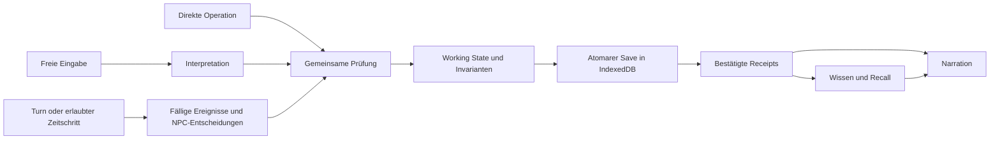

# Living Worlds – Phase 4: Architektur und Entwicklungsplan

Stand: 20.10.2026. Basis: lokales `main` **ccbfa4d**, einschließlich Phasen 1–3. Ausschließlich Living Worlds. Keine Produktlogik geändert; hinzugekommen sind dieser Bericht und eine isolierte Diagnose. Kein Merge, Commit oder Push.

**Nachtrag P0a.1:** Die unten gemessene Abweichung bei `timeStep = 0` beschreibt den Zustand vor der anschließenden Korrektur. `worlds/world-time.js` steuert nun normale Turns, manuelle Schritte und Hintergrundzeit gemeinsam; `world_phase4_architecture_probe.js` und `world_phase4_time_browser_audit.js` prüfen dies einschließlich Save/Reload und Legacy-Session. Die getrennt dokumentierten Routen-, Zugangs-, Reisezeit- und Ereignisfragen bleiben offen.

## 1. Befundkennzeichnung und Empfehlung

**[1]** vorhanden und funktionsfähig · **[2]** vorhanden, unzureichend integriert · **[3]** tatsächlich fehlend · **[4]** gemessener/getesteter Engpass oder Fehler · **[5]** unbestätigte Hypothese. Vorschläge sind ausdrücklich als solche bezeichnet.

**Empfehlung:** Bestehende Engine schrittweise vereinheitlichen. Zuerst Hintergrundzeit, Scheduler und NPC-Vorschläge an dieselben räumlichen Regeln und Transaktionsgrenzen anschließen. Danach den Modellvertrag verkleinern und Narration an bestätigte Ergebnisse binden. Neue Datenbank und umfassender Planner sind gegenwärtig nicht begründet.

**[1]** Horde besitzt bereits eine umfangreiche rundenbasierte Simulation. **[2]** Ihre unterschiedlichen Eintrittspfade teilen noch nicht überall dieselbe Semantik. **[4]** Das betrifft nachweislich die Hintergrundbewegung; außerdem verfehlt der vorhandene große Simulationstest sein Zeitlimit. **[5]** Welcher einzelne Verarbeitungsschritt diesen Zeitbedarf verursacht, ist noch nicht profiliert.

## 2. Lokaler Stand und Upstream

**[1]** `git fetch --no-tags upstream main` lieferte **d957222adcd44d663447c8f75a1abad5ed91e5ac** aus [ddkhan24/hordestudio](https://github.com/ddkhan24/hordestudio/commit/d957222adcd44d663447c8f75a1abad5ed91e5ac). `HEAD...FETCH_HEAD`: **40 lokale, 0 ausschließlich upstream vorhandene Commits**. Der verfügbare aktuelle Upstream ist bereits Vorfahr des lokalen Stands. Es gibt derzeit nichts zusätzlich zu übernehmen.

| Befund | Vergleich und Bewertung |
|---|---|
| [1] Gemeinsamer tragfähiger Bestand | `runLivingWorldTick`, `syncNPCSchedules`, `getWorldTimeData`, `getMemoryMatrixContext` und `saveWorldsState` sind als Funktionsquellen nach Zeilenendennormalisierung identisch. Scheduler, einfache autonome Ziele, Wissenstransfer und Speicherung sind keine neu zu bauenden Systeme. |
| [1] Lokal ergänzte Absicherung | Binding, Working State, registrierte Effekte, verknüpfte Aktionen und Phase-2-Reparaturschutz bestehen in den unten genannten Audits. Diese Erweiterungen erhalten. |
| [1]/[2] Lokale Erweiterungen | `assets/worlds/world-lore.js`, Kontextaufbereitung und Hintergrundmodul kommen hinzu; `runWorldAgent` und `normalizeLivingWorldState` unterscheiden sich. Lore/Kontext sind getestet; die Hintergrundintegration hat konkrete Lücken. Herkunft ist kein Qualitätsnachweis. |
| [4] Gemeinsame Last | Der unveränderte `runLivingWorldTick` verfehlt lokal das Stress-Zeitlimit. Das ist kein belegter Phase-3-Rückschritt; diese Phase änderte den Tick nicht. |

Die [Phase-2-Ergebnisse](world-action-reliability-phase2-2026-10-20.md) und [Phase-3-Vergleiche](world-context-budget-phase3-2026-10-20.md) wurden übernommen, nicht neu erarbeitet.

## 3. Bestands- und Gap-Analyse

Fundstellen beziehen sich auf den oben genannten lokalen Stand; Funktionsnamen bleiben die maßgeblichen Anker.

| Status | Bestand und konkrete Grenze | Fundstelle |
|---|---|---|
| [1] Zustand/Persistenz | World-Definition, sessionbezogene Zustände und Historie; kanonische IndexedDB, komprimierte World-Shards, portable Archive. Isolierte Import-/Fortsetzungsprüfung besteht. | `app.js:3`, `captureWorldTurnState` ab 29693; `large-archive.js`; Kampagnenaudit |
| [1] Actions/Events/Effects | `bind` bindet IDs und Verweise; `executeLinkedActions` prüft Abhängigkeiten, Fähigkeiten, Ereignisbezug und Zustandsinvarianten auf Working State. Reparaturen schützen bereits unabhängig bestätigte Effekte. Modelllabel oder Reducer-Erfolg allein reichen nicht. | `worlds/turn-binding.js:103,303`; `linked-world-actions.js:394`; `working-state.js`; `effect-registry.js` |
| [2] Gemeinsame Verarbeitung | V3-Turns nutzen diese Prüfstrecke. `runWorldAgent` nutzt dagegen erlaubte Felder, `processStructuredActions`, Ablehnungsprüfung und atomaren Save. Tick und Hintergrund verändern Sessionfelder direkt. Atomarität ist vorhanden, gemeinsame fachliche Begründung noch nicht durchgängig. | `app.js:29846,36034,39898,40550`; `worlds/background-sim.js:79` |
| [1] NPC-Autonomie | Routinen, Overrides, Pins, Status, Zielschwierigkeit, Autonomie, Fristen, Fortschritt, authored `goalSteps`, Folgeziele und deterministische Zufallswerte. Abwesende NPCs handeln; anwesende werden vor paralleler Offscreen-Fortschreibung geschützt. | `runLivingWorldTick`; `syncNPCSchedules` ab 40756; 86er-Audit |
| [2] Zielerfüllung | Zielschritte werden aus Fortschritt als konkrete Nachrichten publiziert. Das ist keine allgemeine Prüfung, ob etwa benötigtes Inventar, Zugang oder Ressourcen den beschriebenen Schritt tatsächlich erlauben. | `app.js:40030–40155` |
| [3] Allgemeine Entscheidungsplanung | Im untersuchten World-Ausführungspfad fehlt eine allgemeine Verbindung „individuelle Bedürfnisse → zulässige Operationsalternativen → geprüfte Zielerfüllung“. Vorhandene Stats/Ziele sind dafür Eingaben; authored Schritttexte sind kein ausführbarer Plan. |
| [1] Scheduler/Zeit | Ein Tick je Turn; erneuter Aufruf nach Zeitsprung bearbeitet minutengebundene Ereignisse ohne doppelte Turn-Fortschreibung. Ereignisse, Ortsbedingungen, Märkte, Fraktionen und Konsequenzen existieren. | `getWorldTimeData:37083`, `runLivingWorldTick:39898`, `advanceWorldConsequences:38493` |
| [2]/[4] Hintergrundzeit | Standardmäßig aus; explizites Session-Aus funktioniert. Eigener Graph und eigene Uhrschritte umgehen jedoch bestehende Regeln. Konkrete Gegenprobe unten. | `background-sim.js`; `runWorldBackgroundCatchUp:27946` |
| [1] Wissen/Erinnerung | Lore unterscheidet Publikum, Orte und Zutritt; persönliche Beobachtungen haben Quellen, Ereignis-ID, Konfidenz, Widerspruch und Weitergabeerlaubnis. Recall erhält Quellenbezug und schließt gelöschte/abgelehnte Belege aus. | `assets/worlds/world-lore.js:277,294,399`; `app.js:38386–38435`; `worlds/turn-context.js` |
| [1]/[2] Wahrnehmung/Soziales | Zeugen, Gerüchte durch gemeinsame Anwesenheit und Beziehungen sind implementiert. Quellengebundene Erinnerungen und `worldNews` sind unterschiedliche Sichten; ein Nachrichten- oder Zieltext allein bestätigt keine mechanische Änderung. | `buildNpcLocationIndex`, `spreadWorldKnowledge:39522`, `addNpcKnowledge:38420` |
| [1] Raum/Reisen | Sessioneigene Geografie, IDs, Hierarchien, Zutritt, Ortskenntnis, Routen, Türen und Reisezeiten existieren. Route-Closure-Audit besteht; Graphaudit hat zusätzlich einen Harnessfehler, siehe Tests. | `findWorldTravelPath:17444`, `getWorldTravelLeg:37565`, Lore-Graph |
| [1] Quests/Konsequenzen | Startquests, objektivbezogene Prüfung, Belohnungen, Fristen sowie aktive/eskalierende/abklingende Konsequenzen. Warnungen werden nicht automatisch als eingetretenes fernes Unglück gewertet. | `evaluateQuestProgress:27137`; `createWorldConsequence:38468`; Ereignisverarbeitung im Tick |
| [2] Modellkopplung | Hauptvorschlag verbindet Interpretation, Narration, NPC-Reaktionen, Actions, Events, Effekte und Verpflichtungen. Engine kennt bereits viele verlangte Informationen, muss sie aber gegen Modellwiederholungen abgleichen. | `app.js` Turn-Kontext ab 31331, Vertragsaufbau um 32600–32800; `scene-draft.js` |
| [1]/[4] Kontext | Phase 3 entfernt exakte Duplikate ohne Persistenzänderung. Die Einsparung ist klein gegenüber Schema und Reparaturtext; Messwerte unten. | `turn-context.js`; `turnCallAudit.metrics.contextSources` |

**[1] Keine allgemeine NPC-Obergrenze im Tick:** Die Agenda-Schleife verarbeitet die Session-NPCs; Kontextkürzungen sind keine Ausführungsgrenzen. **[2]** Fraktionsbeziehungen besitzen dagegen `FACTION_PAIR_CAP = 12` und eine bedingte rotierende Auswahl (`app.js:39716,39844`). Das garantiert nicht die Auswertung sämtlicher relevanter Paare. Ein künftiger Ereignisindex muss alle betroffenen Akteure erreichen; Promptbudget und Simulationsberechtigung bleiben getrennt.

### Isolierte Gegenprobe: Hintergrundpfad

**[4]** Ausführen: `node scratch/world_phase4_architecture_probe.js`. Wiederverwendet vorhandene World-Module und den `app_source.js`-Harness; keine echten Spielstände, keine absichtlich fehlschlagende CI-Prüfung.

| Identische Ausgangslage bzw. gezielte Variante | Gemessenes Verhalten |
|---|---|
| Ausgang A, Ziel B, kanonischer Exit `targetLocationId: "b"` | Lore findet B; Hintergrund-BFS liefert `null`, NPC bleibt A. |
| Derselbe Exit zusätzlich mit dem vom Hintergrund gelesenen Alias `to: "b"` | NPC erreicht B trotz `Lore.access(...).ok === false`. |
| Diese Verbindung hat `travelTime: 180` | Ankunft bereits nach einem Hintergrundschritt von 60 Spielminuten. |
| `hudConfig.timeStep = 0`, Hintergrund ausdrücklich aktiviert | Normaler Folgeturn bleibt Minute 480; Hintergrund geht auf 540. Der Zeitstopp wird nicht als übergeordnete Sperre verwendet. |
| Ereignis bei Minute 510, Hintergrund endet bei 540 | Im Hintergrundresultat weiterhin `scheduled`; der Einstieg ruft danach keinen Living-World-Tick auf. Verarbeitung erfolgt erst über einen späteren entsprechenden Tick. |
| Direkter Modulaufruf mit Legacy-Session ohne `worldClock` | Hintergrund rechnet zunächst ab 0 auf 60; normale Uhrabfrage ergibt wieder 480. **Modulgrenzenbefund:** die normale Einstiegsvorbereitung initialisiert die Uhr vorher; kein Nachweis eines allgemeinen Ladefehlers. |

**[1]** Eingabeobjekte bleiben unverändert; Standard-Aus und explizites Session-Aus bleiben wirksam. **[2]** `catchUp` kopiert World/Session pro Schritt und verarbeitet große Lücken in Stundenstücken; wiederholte Ereignisse werden hier nicht gemeinsam mit dem normalen Scheduler abgearbeitet. **[5]** Der Anteil dieser Kopien an realer Ladezeit ist ungemessen.

## 4. LLM-Belastung und Modellvarianten

**[4]** Erneut gemessen mit `world_context_budget_browser_audit.js`, deterministische Modellantworten, reale serialisierte Requests. Vorherwerte aus dem identischen Phase-3-Vergleich:

| Fixture | Zeichen vorher → aktuell | Calls / Reparaturen aktuell; vorher gleich |
|---|---:|---:|
| klein | 58.742 → 58.249 | 1 / 0 |
| dicht, 18 Orte/8 NPCs/lange Historie | 88.030 → 84.943 | 1 / 0 |
| Szenenwechsel | 76.637 → 75.086 | 1 / 0 |
| Reparatur | 87.995 → 84.908 | 2 / 1 |
| gemischte V2/V3-Fortsetzung | 78.117 → 75.030 | 2 / 0, über zwei Turns |

**[4]** Im dichten aktuellen Fixture: Schema **35.859**, Lore **9.185**, NPC-Perspektiven **8.133**, Ledger/Archiv **1.095**, Quellen-Recall **1.251**, Szenenanweisung **3.402** Zeichen. Reparaturrequest **41.943** Zeichen. Quellenwerte sind keine garantiert disjunkte Zerlegung des Gesamtrequests. **[1]** `turnCallAudit` kann Dauer, Aufrufart und vorhandene Provider-Usage erfassen; Zeichenzahl/3,2 ist nur eine Tokenschätzung. **[3]** Hier fehlen Live-Modellmessungen für echte Eingabetokens, Qualitätsquote und Latenz; daraus werden keine Gewinne abgeleitet.

**[2]** Zusatzaufrufe entstehen bedingt durch Provider-Fallback, bis zu zwei Receipt-Reparaturen, Narrationskorrektur, Legacy-Klassifikation, optionalen Sensor, Embeddings, episodische Konsolidierung und aktivierten WorldAgent. Der WorldAgent besitzt bereits Intervall-/Bedarfsgating, Stale-Response-Schutz und ist standardmäßig aus. Er soll vorhandene einfache Simulation nicht erneut erledigen.

**Vorschlag – Variantenvergleich; Angaben sind Architekturbudgets, keine gemessenen Verbesserungen:**

| Variante | Zuverlässigkeit / Calls | Tokens, Latenz, Wartung |
|---|---|---|
| Ein Modell, kombinierter Vorschlag | Meist 1 Hauptcall, bedingte Reparaturen. Gemeinsame Validierung bleibt zwingend. Vorab-Prosa kann abgelehnten Resultaten widersprechen. | Bestehender großer Vertrag; geringster Umbau, weiterhin Kopplung. |
| Interpreter + separater Narrator | Normalerweise 2 serielle Calls; Narrator erhält ausschließlich bestätigte Ergebnisse plus erlaubtes Wissen. | Kleinere Einzelaufgaben können kleinen Modellen helfen; Gesamttokens und Wartezeit können steigen. Zusätzliche Fehler-/Fallbackgrenze. |
| Direkte Engine-Aktionen | 0 Interpretationscalls für explizite registrierte Operationen; Narration 0 mit Vorlage oder 1 optional. | Für bekannte Aktionen gut prüfbar und kleines Kontextbudget; freie Sprache benötigt weiterhin Interpretation. Keine zusätzlichen Verbparser. |
| Hybrid, empfohlen | Direkte Operationen/Routinen ohne Interpretation; freie Sprache über kompakten Vorschlag; komplexe NPC-Entscheidung nur bei tatsächlichem Bedarf. Narration optional getrennt. | Mehr Routingtests, aber gemeinsame Engine. Anzahl 0/1/2 je Pfad; Einsparung muss pro Pfad gemessen werden. |

**Vorschlag:** Engine löst IDs, Route, Dauer, Würfel, Abhängigkeiten und bestätigte Wirkungen aus ihren vorhandenen Daten. Ein kompakter Modelladapter schlägt Operationen mit Argumenten und Bezug zur Eingabe vor; er ersetzt nicht das interne Action-/Event-/Effect-Format. Für Modelle ohne zuverlässiges JSON können Engine-Menüs/Operations-IDs und reine Narration dienen. Unaufgelöste freie Sprache bleibt rückfragbar, niemals automatisch wirksam.

## 5. Öffentliche Vorbilder und Technologieabwägung

**[1 – externe Dokumentation] AI Town:** Die [offizielle Architektur](https://github.com/a16z-infra/ai-town/blob/main/ARCHITECTURE.md) trennt Regeln, Engine, Agenten und UI. Agenten senden validierte Inputs; die Engine besitzt den Weltzustand. Asynchrone Modellarbeit kehrt als Input zurück, Generationen schützen gegen veraltete Arbeit. Erinnerungen verwenden Zusammenfassung, Embeddings und Cache. **Vorschlag:** Verantwortungsgrenzen übernehmen. Echtzeitticks und Convex nicht übernehmen. Die Dokumentation benennt das vollständige Laden aktiver Welten als Skalierungsgrenze; sie beweist keine Skalierung auf beliebig viele Agenten.

**[1 – externe Dokumentation] Voyage:** Die [öffentliche Produktbeschreibung](https://voyage.io/press) beschreibt persistente Charaktere, Inventar, Beziehungen und Konsequenzen sowie KI-Erzählung. **[5]** Interne Planner, individuelle NPC-Modellaufrufe, Datenbank und Scheduler sind damit nicht belegt. **Vorschlag:** Persistenz und nachvollziehbare Konsequenzen als Produktziele verwenden; keine vermeintliche interne Architektur nachbauen.

| Option | Bewertung gegenüber Bestand / Entscheidungsvorschlag |
|---|---|
| Strukturierte, rekonstruierbare Indizes | **[1]** Lore hat bereits temporäre ID-Indizes, Tick einen Ortsindex; Recall nutzt Quellen und Akteure. **Vorschlag:** Bei gemessener Scanlast gezielt Ereignisfälligkeit, Akteur/Ort/Quell-ID indizieren. IndexedDB bleibt kanonisch; Indexversion, Session-/Epoch-Bezug und Neuaufbau erforderlich. |
| SQLite / FTS5 | **[1 – extern]** [FTS5](https://www.sqlite.org/fts5.html) bietet Volltextsuche, Ranking und Index-Neuaufbau. **[5]** Ein Vorteil gegenüber vorhandenem Recall ist hier nicht gemessen. **Vorschlag:** Zurückstellen; erst bei belegten Problemen langer lexikalischer Archivsuche als ableitbaren Suchindex benchmarken. Keine zweite verbindliche World-Datenbank; zusätzlicher Desktop-/Browserbetrieb wäre Aufwand. |
| Vektorsuche | **[1]** `getMemoryMatrixContext`/`HordeVectorMemory` bieten bereits optionale Embeddings, Cache und episodische Suche. **[5]** Ein weiterer Index verbessert Recall nicht nachweislich. **Vorschlag:** Vorhandene Suche gegen paraphrasierte Langzeitfragen messen; Rechte-/Quellenfilter vor und nach Ranking beibehalten. Embeddings niemals zu objektiven Fakten machen. |
| Quellengebundenes Wissen | **[1]** Beobachtungsarten `witnessed/told/public/suspected/believed/life_seed/unknown`, Konfidenz und Ereignisbezug existieren. **Vorschlag:** Projektionen aus bestätigten Ereignissen vereinheitlichen; objektive Effekte, persönliche Wahrnehmung, Überzeugung und Gerücht getrennt halten. Keine neue Memory-Architektur. |
| Utility AI | **[1 – extern]** [Utility-Theorie](https://www.gameaipro.com/GameAIPro/GameAIPro_Chapter09_An_Introduction_to_Utility_Theory.pdf) bewertet Alternativen anhand von Faktoren. **Vorschlag, experimentell:** kleine Auswahl zwischen schon zulässigen Operationen anhand vorhandener Ziele/Fristen/Beziehungen. Kosten-/Verhaltensvorteil noch **[5]**; keine Pflichtbedürfnisse für Altwelten. |
| GOAP | **[1 – extern]** [Orkins Planung](https://www.gamedevs.org/uploads/three-states-plan-ai-of-fear.pdf) sucht Aktionsfolgen zu Zielzuständen. **Vorschlag:** erst wenn einfache Auswahl nachweislich an mehrstufigen Ressourcen-/Zugangsaufgaben scheitert. Erfordert verlässliche Vorbedingungen und Effekte; Freitextziele allein reichen nicht. |
| Behavior Trees | **[1 – extern]** [Epic dokumentiert ereignisgetriebene Bäume](https://dev.epicgames.com/documentation/en-us/unreal-engine/behavior-tree-in-unreal-engine---overview). **Vorschlag:** nur für komplexe authored Abläufe mit Abbruch/Erholung prüfen. Für heutige Zeitpläne und einfache Goal-Pools wäre ein zusätzlicher Baum zunächst Doppelverwaltung. |

## 6. Zielarchitektur: zwei realistische Integrationsansätze

### A – Bestand über gemeinsame Eintrittspunkte verbinden (empfohlen)

**Vorschlag:** `app.js` orchestriert weiterhin. Bestehende Module erhalten kleine Adapter; interne Actions, Events, Effects, Reactions, Receipts und Speicherformate bleiben bestehen. Direkte Operationen, Spielerinterpretation, NPC-Entscheidung und Scheduler speisen denselben geprüften Änderungspfad. Vorteile: begrenzter Umbau und schrittweise Altspielstandtests. Nachteile: zunächst weiterhin große `app.js`, mehrere Modellprotokolle und Adapter.

### B – Reinen Simulationsschritt aus dem Bestand extrahieren

**Vorschlag:** Bestehende Regeln später als UI-unabhängigen Aufruf `advance(snapshot, trigger) → candidate + receipts` zusammenfassen; `app.js` bleibt Speicher-/Modelladapter. Optional Worker für rechenintensive Schritte. Vorteile: deterministischer Replay, Profilierung und isolierte Agententests leichter. Nachteile: viele implizite globale Abhängigkeiten, größere Kompatibilitätsfläche und Snapshot-/Kopierkosten. Kein Neubau der Regeln und keine zweite kanonische Welt. Erst nach Ansatz A und Profilierung separat abstimmen.

### Gemeinsame Verantwortlichkeiten und Schnittstellen

Die folgenden Schnittstellen sind **Vorschläge**, keine neuen gespeicherten Schemas:

| Verantwortung | Bestand / Entscheidung | Vertrag |
|---|---|---|
| Zustand und atomarer Abschluss | HordeDB, Working State, Snapshot/Rollback **weiterverwenden** | `{world, session, epoch}` lesen; geprüften Kandidaten speichern; erst nach Save bestätigen. Fehler bewahren Eingabe und Vorzustand. |
| Interpretation | `model-client.js`, V3-Vertragsaufbau **erweitern** | Eingabe + zulässige Fähigkeiten + gezielter Kontext → Vorschlag mit Akteur, Argumenten und Eingabebezug. Keine Schreibrechte. |
| Prüfung/Ausführung | Binding, Compiler, Registry, `executeLinkedActions` **weiterverwenden/vereinheitlichen** | Vorschlag + Vorzustand → validierte Operationen, Abhängigkeitsergebnisse, bestätigte Effekte/Ereignisse oder Fehler. Akteur allein ändert die Regeln nicht. |
| Zeit und Aktivierung | `runLivingWorldTick`, `syncNPCSchedules`, Background **zusammenführen** | Spielerturn / expliziter Schritt / erlaubtes Nachholen → fällige Arbeit; Pause und Zeitbasis zuerst prüfen. Private Hintergrund-Routenlogik **ersetzen**. |
| NPC-Entscheidung | Routinen, Goals, WorldAgent **erweitern** | Akteurswissen + Ziele + gültige Optionen → Operation oder begründetes Warten/Blockiertsein; LLM nur bei ungeklärter komplexer Entscheidung. |
| Wissen/Recall | Lore, Beobachtungen, Ledger, `turn-context.js` **weiterverwenden** | Bestätigte Ereignisse + Zeugen → persönliche Projektionen; Abfrage nach Akteur/Ort/Thema/Budget mit Herkunft. |
| Narration | Vorhandenen Narrationspfad **entkoppeln** | Bestätigte Receipts + erlaubtes Wissen + offene Fragen → Text ohne Effects oder Schreibzugriff. Prüfung/Fallback darf keine neuen Fakten committen. |

**Vorschlag für rundenbasierte Aktivierung:** Alle fälligen Ereignisse und betroffenen Akteure berücksichtigen. Entfernte NPCs können bis zur nächsten entscheidungsrelevanten Zeitgrenze springen; Ressourcen, Fristen und soziale Folgen müssen denselben Ergebniszustand wie Referenzschritte liefern. LLM-Arbeit darf gesammelt/verschoben werden, aber Akteure nicht durch „erste N NPCs“ verschwinden. Offene Arbeit bleibt nachvollziehbar und fair fortsetzbar; kein Abbruch allein wegen Szenenferne.

**[2]** Bestehende wiederholte Ereignisse werden nach Auslösung relativ zur aktuellen Zeit neu terminiert. **Vorschlag:** Vor Beschleunigung klären und testen, welche Ereignisse zusammenfassbar sind und welche jede Auslösung benötigen. Keine stillschweigende Änderung dieser Semantik für Altwelten.

## 7. Priorisierte, unabhängig prüfbare Arbeitspakete

Alle Pakete nutzen vorhandene Audits. Aufwand ist relativ, kein Zeitversprechen. Keine neue externe Technologie in P0–P2 erforderlich.

| Paket / Status / Aufwand | Bestand und konkrete Arbeit | LLM-Nutzen; Abhängigkeiten | Risiko und reproduzierbare Abnahme |
|---|---|---|---|
| **P0a Hintergrundregeln**, erforderlich, mittel | `background-sim.js`, `runWorldBackgroundCatchUp`, Zeit-/Routen-/Schedulerfunktionen: gemeinsame Exit-Auflösung, Zutritt, Zeitbasis, Pause, Fälligkeit verwenden. | Verhindert widersprüchlichen Kontext und nachträglichen Erklärbedarf; kein gemessener Callgewinn. Unabhängig von Schemaarbeit. | Reise-/Nachholverhalten kann sich ändern. Diagnose in echte Solltests überführen: kanonische/Legacy-Exits, verweigerter Zutritt, lange Reise, Zeitstopp, moduldeaktivierte/dead/pinned NPCs, mehrere fällige Events, Savefehler. Standard-Aus unverändert. |
| **P0b Gemeinsame Bestätigung**, erforderlich für Zielarchitektur, mittel | `runWorldAgent`, `processStructuredActions`, Binding/Registry/Working State: Akteurs- und Herkunftsadapter; gleiche Vorbedingungen, Dependencies, Witnesses und Savegrenze. | Engine übernimmt Weltregelprüfung vollständig; weniger Modellwidersprüche als Ziel, noch ungemessen. Auf bestehender V3-Strecke aufbauen; parallel zu P0a prüfbar. | Gültige alte Vorschläge nicht verlieren. Dieselbe Spieler-/NPC-/Scheduler-Operation erhält dasselbe Ergebnis; unbegründeter Effekt verworfen; bestätigter Effekt reparaturfest; Stale-Response/Savefehler ohne Teilcommit. |
| **P1a Kompakter Modellvertrag**, Optimierung durch Messung begründet, mittel | V3-Prompt in `app.js`, `turn-binding.js`, `effect-registry.js`: verfügbares Operationsangebot aus Registry; kompakte externe Vorschläge in bestehende interne Strukturen übersetzen. Reparatur erhält gezielte Fehler und erforderlichen Kontext. | Größten gemessenen Schema-/Reparaturanteil adressieren. Logisch unabhängig von NPC-Planung; P0b als gemeinsamer Zielpfad. | Modellkompatibilität: bisherigen V2/V3-Vertrag als Fallback behalten. Identische Phase-3-Fixtures: kleinere serialisierte Requests, gleiche benötigte Fakten/Resultate, keine zusätzlichen Calls/Reparaturen. Live-Tests getrennt ausweisen. |
| **P1b Receipt-Narration**, Zielanforderung, mittel | Bestehenden Narrations-/Nachprüfpfad in `app.js` und `scene-draft.js` nur mit bestätigten Ergebnissen speisen; direkte Engine-Aktionen mit optionalem Erzähler. | Kein vollständiges Action-JSON vom Narrator. Zweiter Call nur bewusst gewählter Pfad; Callbudget vorher festlegen. Auf bestehende Receipts stützbar, kein neuer Store. | Erzählte falsche Erfolge: geblockte/übersprungene Effekte dürfen nicht erscheinen; alte Erinnerungen und offene Verpflichtungen bleiben zugänglich. Mehrturnige V2/V3- und Reparaturtests plus kleines lokales Modell vor Freigabe. |
| **P1c Profilierung und fällige Arbeit**, Engpass belegt, zunächst klein | `runLivingWorldTick`, Normalisierung, Fraktions-/Wissensverarbeitung und Catch-up getrennt messen; dann genau den dominanten Scan/Kopiervorgang oder die Fälligkeitsauswahl optimieren. | Deterministische Simulation skaliert ohne NPC-LLM-Aufrufe. Unabhängig von Modellvertrag; Background-Optimierung nach P0a. | Kein NPC darf aus Budgetgründen verschwinden. 5.000-NPC-Test wiederholt unter bestehendem 15-s-Gate; gleiche Zustände/Ereignisse wie Referenz, große Zeitsprünge gegen Einzelschritte. Keine Grenzwertanhebung als Optimierung. |
| **P2 Geprüfte autonome Zielschritte**, erforderlich für mechanische Autonomie; Auswahlverfahren experimentell, mittel | `runLivingWorldTick`, Goals/Routinen, WorldAgent: optionale ausführbare Schrittverweise auf bestehende Operationen; Zielabschluss anhand bestätigter Ergebnisse. Kleine Utility-Auswahl erst als Vergleich. | Routinen und einfache Zielentscheidungen ohne Modell. Benötigt P0b; neue Technik zunächst nur JS-Regeln. | Freitext-Altziele erhalten ihr bisheriges Verhalten, kein automatischer Verbparser. Verschiedene Akteure, Ressourcen, Beziehungen, Zugangsänderungen und entfernte Szenen; keine kostenlose Zielerfüllung, keine Dauerblockade, deterministischer Replay. |
| **P3 Recall-Indexexperiment**, optional, klein bis mittel | `turn-context.js`, Lore-Indizes, `getMemoryMatrixContext`: große Quellen-Fixtures und Abfragezeiten messen; nur bei belegtem Bedarf abgeleiteten Index vergleichen. | Weniger Sucharbeit und gezielter Kontext, Gewinn bisher Hypothese. Unabhängig von Planner; FTS5/zusätzliche Vektortechnik erst zweite Entscheidung. | Heimliche Wissenslecks/Verlust: persönliche Erinnerung, alte Zusage, falsches Gerücht, entfernte Information und gelöschte Quelle korrekt unterscheiden; Index löschen/neu aufbauen → gleiche zulässigen Treffer; Saveformat unverändert. |

**Vorschlag:** P0a und P0b zuerst mit ddkhan24 abstimmen; anschließend P1a als größter belegter Prompthebel. P1c lässt sich unabhängig profilieren. GOAP, große Behavior-Tree-Infrastruktur, SQLite-Migration und umfassende Engine-Extraktion sind keine Voraussetzung.

## 8. Kompatibilität, Risiken und Testnachweis

**[1]** Versionsbegriffe sind getrennt: World-Schema (`WORLD_SCHEMA_VERSION = 4`), IndexedDB-Version, Archivversion und V2/V3-Turnprotokoll sind keine gemeinsame Versionszahl. **Vorschlag:** Adapter nach tatsächlich vorgefundenen Feldern/Versionen wählen; optionale neue Laufzeitfelder mit sicheren Defaults. Originalexport behalten; unvermeidbare Migration nur versioniert, mit Sicherung und Vergleich.

| Prüfebene | Nachweis / offene Grenze |
|---|---|
| **[1] Speicher** | Synthetische Legacy-V1-Importe, World-/Kampagnen-/Installationsarchive, Medien, Shards, beschädigte Archive und atomarer Restore im bestehenden Kampagnenaudit geprüft. |
| **[1] Verarbeitung** | NPC-Erinnerungen, Lore/Zugang, offene Verpflichtungen, Aktionen/Effekte und gezielter Recall in deterministischen Fixtures geprüft. Die neue Hintergrunddiagnose zeigt die oben benannten Ausnahmen **[4]**. |
| **[1] Fortsetzung** | Legacy-V1 → zwei V3-Turns mit Spieler-/NPC-Effekten und Reload; gemischte V2/V3-Fortsetzung im Kontextaudit. Vorhandene Felder/Referenzen bleiben in diesen Fixtures erhalten. |
| **[3] Reale Altspielstände** | Keine echten `.horde_campaign`-Altarchive im Repository verfügbar. `world_real_save_continuation_audit.js` benötigt solche isolierten Kopien. Keine Behauptung, sämtliche existierenden Welten seien damit abgedeckt. |
| **[5] Langzeitrisiken** | Neue Agenten können alte Geschichten durch andere Entscheidungsprioritäten verändern; neue Indizes können veralten; Retentionsgrenzen von News/Zielhistorie sind kein vollständiges Replaylog. Neue Funktionen benötigen Fortsetzungsgoldens, Epoch-Invalidierung und ausdrücklich getestete Aufbewahrung. |

**Verbindliche vorgeschlagene Freigabe für jedes Folgepaket:** Originale in isolierten Kopien laden; Definitionen, IDs/Referenzen, NPCs, Erinnerungen, Beziehungen, Inventar, Orte, Quests, Verpflichtungen, Uhr und Historie vor/nach vergleichen. Mehrere Turns mit NPC-Handlungen und dauerhaften Effekten, Speichern/Reload und Export/Import durchführen. Keine neue Standardautonomie oder Hintergrundzeit für alte Welten aktivieren. Gültige Effekte erhalten, unbegründete ablehnen. Bei unaufgelöstem Konflikt kein Zustandscommit; Spielereingabe bleibt erhalten.

### In Phase 4 ausgeführte Prüfungen

Alle Pfade unter `scratch/`; Node v24.11.1. Browseraudits mit bestehendem Playwright-Harness und lokalem Chrome in isolierten Kontexten. Kampagnenaudit mit `HORDE_WORLDS_ONLY=1`.

| Audit | Ergebnis |
|---|---|
| `living_world_audit.js` | **86/86 bestanden**. |
| `living_world_stress_test.js` | **Zeitgate fehlgeschlagen**, 16.316 ms; Wiederholung ohne weitere parallel gestartete lokale Tests 17.338 ms. Grenze 15.000 ms; 2.000 Orte, 5.000 NPCs, 500 Events, 200 Fraktionen, 120 Turns. Vorgelagerte Zustandsassertions bestanden. VM-/Harnessmessung, keine Browser- oder LLM-Latenz. |
| `world_agent_transaction_audit.js` | Bestanden: Ablehnung/Savefehler rollen zurück, Feedback nach Save. |
| `world_gesture_effect_repro_audit.js` | **6/6 bestanden**, Aslan und allgemeine Gegenproben. |
| `world_server_binding_audit.js` | Bestanden, einschließlich NPC-Bewegung, Reparaturschutz und Rollback. |
| `world_context_budget_browser_audit.js` | Bestanden; aktuelle Werte oben, First-Pass/Reparatur/Recall/Fortsetzung geprüft. |
| `world_long_memory_audit.js`, `world_npc_knowledge_recall_audit.js` | Beide bestanden. |
| `worlds2_route_closure_audit.js` | Bestanden. |
| `worlds2_atomic_turn_persistence_browser_audit.js` | Bestanden: ausstehender Turn bleibt während Embedding-Diagnostik und nach Reload uncommittet. |
| `worlds2_campaign_browser_audit.js` | Alle Assertions bis zur abschließenden PASS-Meldung bestanden, einschließlich V1-Fortsetzung. Prozess beendete sich danach nicht selbst; nach ausbleibender weiterer Ausgabe abgebrochen. **Kein sauberer Gesamtprozess-Pass.** Cleanup-Harness separat untersuchen. |
| `world_graph_consistency_audit.js` | 8/8 fachliche Checks, danach asynchroner Harnessfehler `ReferenceError: document is not defined` in `showToast`; Exit 1. **Kein grüner Gesamtlauf.** |
| `world_phase4_architecture_probe.js` | Diagnose erfolgreich, Input unverändert; reproduziert die Hintergrundabweichungen. Keine Kompatibilitätsfreigabe. |

**[1]** Die Phase-3-Berichte dokumentieren bereits zwei weitere bekannte Browserfehler (`world_scene_draft_browser_audit`, `world_lore_browser_audit`) auf damaliger Basis und optimiertem Stand. Hier nicht erneut ausgeführt und nicht als bestanden gezählt. **[3]** Live-Modellqualität, reale historische Nutzerarchive und Ursachenprofil des Stressengpasses bleiben offen.

**Ergebnis zur Abstimmung:** Gemeinsame Engine-Regeln und bestätigte Ergebnisse sind der nächste notwendige Schritt. Der große Modellvertrag ist der stärkste gemessene Hebel zur LLM-Entlastung. Eine neue Datenbank oder umfassende Planner-Architektur lässt sich aus den vorliegenden Messungen nicht rechtfertigen.
